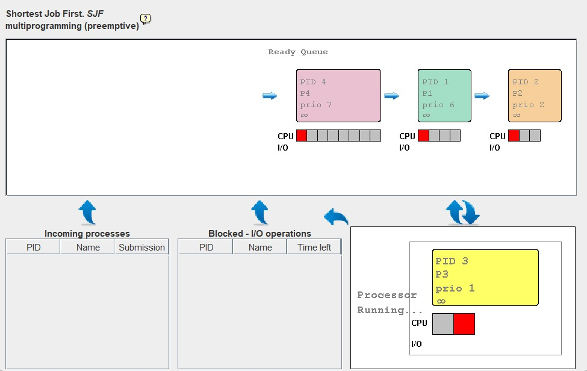
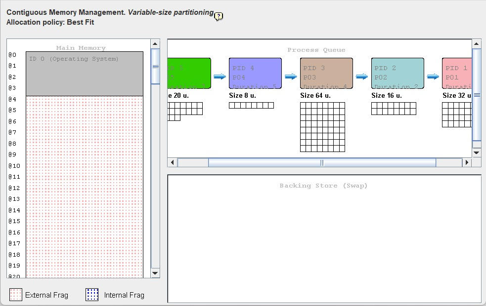
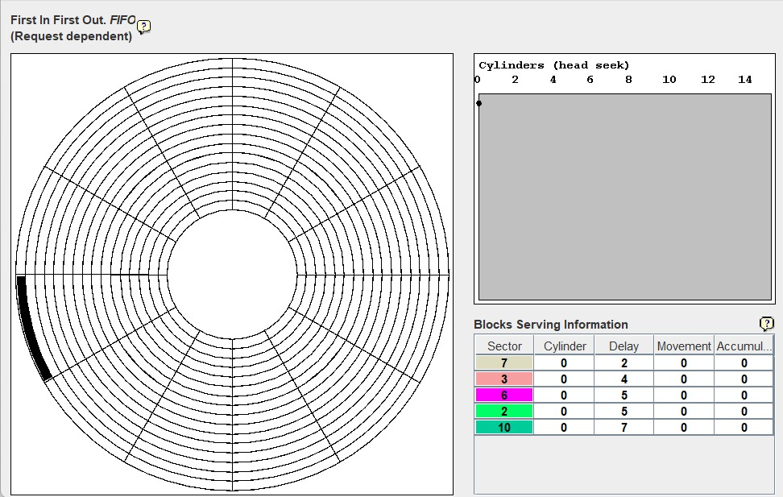

# Operating Systems Practicals

Practical 1 is an OS simulator demo, Practical 2 and 3 are Linux commands, and Practical 4 to 12 are Python programs (run every file from the VS Code terminal).

> Use whichever works on your computer: `python filename.py`, `python3 filename.py` or `py filename.py`. (On older Windows PCs and Linux, `python3` or `py` may be the one that works. All commands below are written with `python`.)

---

## Practical 1: Operating System functions using OS Simulator

**Question:** Demonstration of various Operating System functions using OS Simulator.

**Tool used:** OS Sim (a Java-based operating system simulator). It has four modules: CPU (process scheduling), RAM (memory management), File System and Disk (disk scheduling).

**Main window**


**CPU scheduling: Shortest Job First (SJF, preemptive)**



**Memory management: contiguous allocation, variable-size partitions (Best Fit)**



**Disk scheduling: FIFO (First In First Out)**



**Explanation:**
- CPU scheduling decides which process gets the CPU next. SJF picks the process with the shortest burst time.
- Memory management decides where each process is placed in memory. Best fit uses the smallest free partition that is big enough.
- Disk scheduling decides the order in which disk requests are served. FIFO serves them in the order they arrive.

---

## Practical 2 and 3: Setup

Practical 2 and 3 are Linux commands (Kali, Ubuntu or WSL). Create the sample files first and keep them for both practicals.

```bash
echo "hello world" > file1.txt
printf "apple\nbanana\ncherry\n" > file2.txt
printf "apple\nmango\ncherry\n" > file3.txt
ls
cat file1.txt file2.txt file3.txt
```

**Sample output:**
```text
$ ls
file1.txt
file2.txt
file3.txt
$ cat file1.txt file2.txt file3.txt
hello world
apple
banana
cherry
apple
mango
cherry
```

---

## Practical 2(i): Information maintenance

**Question:** Execute various Linux commands for information maintenance: wc, clear, cal, who, date, pwd.

**Commands:**
```bash
wc file2.txt
cal
who
date
pwd
clear
```

**Sample output** (names, dates and process IDs will be different on your system):
```text
$ wc file2.txt
 3  3 20 file2.txt
$ cal
   November 2026
Su Mo Tu We Th Fr Sa
 1  2  3  4  5  6  7
 8  9 10 11 12 13 14
15 16 17 18 19 20 21
22 23 24 25 26 27 28
29 30
$ who
(lists the users who are logged in)
$ date
Wed Nov 25 00:42:37 UTC 2026
$ pwd
/home/user
$ clear
(clears the terminal screen)
```

**What the commands do:**

| Command | Purpose |
|---|---|
| `wc file2.txt` | counts lines, words and bytes of a file |
| `cal` | shows the calendar (install with `sudo apt install ncal` if it is missing) |
| `who` | lists the users who are logged in |
| `date` | shows the current date and time |
| `pwd` | prints the present working directory |
| `clear` | clears the terminal screen |

---

## Practical 2(ii): File management

**Question:** Execute various Linux commands for file management: cat, cp, rm, mv, cmp, comm, diff, find, grep, awk.

**Commands:**
```bash
cat file1.txt
cp file1.txt copy1.txt
mv copy1.txt renamed.txt
cmp file2.txt file3.txt
comm file2.txt file3.txt
diff file2.txt file3.txt
find . -name "*.txt"
grep "apple" file2.txt
awk '{print NR, $0}' file2.txt
rm renamed.txt
```

**Sample output** (names, dates and process IDs will be different on your system):
```text
$ cat file1.txt
hello world
$ cp file1.txt copy1.txt
$ mv copy1.txt renamed.txt
$ cmp file2.txt file3.txt
file2.txt file3.txt differ: char 7, line 2
$ comm file2.txt file3.txt
		apple
banana
cherry
	mango
comm: file 2 is not in sorted order
	cherry
comm: input is not in sorted order
$ diff file2.txt file3.txt
2c2
< banana
---
> mango
$ find . -name "*.txt"
./file2.txt
./file3.txt
./renamed.txt
./file1.txt
$ grep "apple" file2.txt
apple
$ awk '{print NR, $0}' file2.txt
1 apple
2 banana
3 cherry
$ rm renamed.txt
```

**What the commands do:**

| Command | Purpose |
|---|---|
| `cat` | displays the contents of a file |
| `cp` | copies a file |
| `mv` | moves or renames a file |
| `cmp` | compares two files byte by byte and reports the first difference |
| `comm` | compares two sorted files in three columns (only in file 1, only in file 2, in both); it warns if a file is not sorted |
| `diff` | shows which lines differ between two files |
| `find` | searches for files by name |
| `grep` | prints the lines that contain a pattern |
| `awk` | processes text line by line (here it prints the line number and the line) |
| `rm` | deletes a file |

---

## Practical 2(iii): Directory management

**Question:** Execute various Linux commands for directory management: cd, mkdir, rmdir, ls.

**Commands:**
```bash
mkdir demo
cd demo
pwd
cd ..
ls
ls -l
mkdir demo2
rmdir demo2
```

**Sample output** (names, dates and process IDs will be different on your system):
```text
$ mkdir demo
$ cd demo
$ pwd
/home/user/demo
$ cd ..
$ ls
demo
file1.txt
file2.txt
file3.txt
$ ls -l
total 16
drwxr-xr-x 2 user user 4096 Nov 25 00:42 demo
-rw-r--r-- 1 user user   12 Nov 25 00:42 file1.txt
-rw-r--r-- 1 user user   20 Nov 25 00:42 file2.txt
-rw-r--r-- 1 user user   19 Nov 25 00:42 file3.txt
$ mkdir demo2
$ rmdir demo2
```

**What the commands do:**

| Command | Purpose |
|---|---|
| `mkdir` | creates a directory |
| `cd` | changes the current directory (`cd ..` goes one level up) |
| `ls, ls -l` | lists files; `-l` gives the long format with permissions, owner, size and date |
| `rmdir` | removes an empty directory |

---

## Practical 3(i): Process control

**Question:** Execute various Linux commands for process control: fork, getpid, ps, kill, sleep.

**Commands:**
```bash
echo $$
sleep 100 &
ps
ps -f
kill $!
ps
```

**Sample output** (names, dates and process IDs will be different on your system):
```text
$ echo $$
326
$ sleep 100 &
$ ps
  PID TTY          TIME CMD
  326 ?        00:00:00 -bash
  327 ?        00:00:00 sleep
  328 ?        00:00:00 ps
$ ps -f
UID        PID  PPID  C STIME TTY          TIME CMD
user       326   150  0 00:42 ?        00:00:00 -bash
user       327   326  0 00:42 ?        00:00:00 sleep 100
user       329   326  0 00:42 ?        00:00:00 ps -f
$ kill $!
$ ps
  PID TTY          TIME CMD
  326 ?        00:00:00 -bash
  330 ?        00:00:00 ps
```

**What the commands do:**

| Command | Purpose |
|---|---|
| `echo $$` | prints the PID of the current shell (like getpid) |
| `sleep 100 &` | runs `sleep` for 100 seconds in the background |
| `ps, ps -f` | lists running processes (`-f` is the full format with the parent PID) |
| `kill $!` | terminates the last background process (`$!` holds its PID) |
| `fork()` | demonstrated with programs in Practical 4 |

---

## Practical 3(ii): Communication (redirection and pipe)

**Question:** Execute various Linux commands for communication: input-output redirection and pipe.

**Commands:**
```bash
ls > list.txt
cat list.txt
echo "extra line" >> list.txt
sort < list.txt
ls | wc -l
cat file2.txt | grep an
```

**Sample output** (names, dates and process IDs will be different on your system):
```text
$ ls > list.txt
$ cat list.txt
demo
file1.txt
file2.txt
file3.txt
list.txt
$ echo "extra line" >> list.txt
$ sort < list.txt
demo
extra line
file1.txt
file2.txt
file3.txt
list.txt
$ ls | wc -l
5
$ cat file2.txt | grep an
banana
```

**What the commands do:**

| Command | Purpose |
|---|---|
| `>` | redirects output to a file (overwrites it) |
| `>>` | appends output to a file |
| `<` | takes input from a file |
| `\|` | pipe: sends the output of one command as the input of the next |

---

## Practical 3(iii): Protection management

**Question:** Execute various Linux commands for protection management: chmod, chown, chgrp.

**Commands:**
```bash
ls -l file1.txt
chmod 755 file1.txt
ls -l file1.txt
chmod 600 file1.txt
ls -l file1.txt
sudo chown $USER file1.txt
chgrp $(id -gn) file1.txt
ls -l file1.txt
```

**Sample output** (names, dates and process IDs will be different on your system):
```text
$ ls -l file1.txt
-rw-r--r-- 1 user user 12 Nov 25 00:42 file1.txt
$ chmod 755 file1.txt
$ ls -l file1.txt
-rwxr-xr-x 1 user user 12 Nov 25 00:42 file1.txt
$ chmod 600 file1.txt
$ ls -l file1.txt
-rw------- 1 user user 12 Nov 25 00:42 file1.txt
$ sudo chown $USER file1.txt
$ chgrp $(id -gn) file1.txt
$ ls -l file1.txt
-rw------- 1 user user 12 Nov 25 00:42 file1.txt
```

**What the commands do:**

| Command | Purpose |
|---|---|
| `chmod 755` | owner can read, write and execute; group and others can read and execute (`rwxr-xr-x`) |
| `chmod 600` | only the owner can read and write (`rw-------`) |
| `chown` | changes the owner of a file |
| `chgrp` | changes the group of a file |

---

## Practical 4(i): Same program, same code

**Question:** Write a program (using fork() and/or exec()) where parent and child execute the same program, same code.

**File:** `04a_same_code.py`

```python
import os
from multiprocessing import Process


def show(role):
    print(f"Hello from {role} | PID = {os.getpid()} | Parent PID = {os.getppid()}")


if __name__ == "__main__":
    child = Process(target=show, args=("CHILD",))
    child.start()          # create the child process
    show("PARENT")         # parent runs the same function
    child.join()
```

**Run:**
```bash
python 04a_same_code.py
```

**Output** (process IDs will be different every time):
```text
Hello from PARENT | PID = 11768 | Parent PID = 12440
Hello from CHILD | PID = 11496 | Parent PID = 11768
```

**Explanation:**
- `Process(target=show, ...)` creates a child process. It is the portable version of `fork()` and works on Windows and Linux.
- `child.start()` starts the child. After that, parent and child both run the same function `show()`.
- `os.getpid()` gives the process ID and `os.getppid()` gives the parent's ID. The child's Parent PID equals the parent's PID.
- `child.join()` lets the parent finish only after the child.
- `if __name__ == "__main__":` is required on Windows, otherwise the child re-runs the whole script.

---

## Practical 4(ii): Same program, different code

**Question:** Write a program (using fork() and/or exec()) where parent and child execute the same program but different code.

**File:** `04b_different_code.py`

```python
import os
import sys
import subprocess
from multiprocessing import Process


def child_task():
    print(f"CHILD  (PID {os.getpid()}): running child code")
    print("CHILD  : now starting another program (exec-like)")
    subprocess.run([sys.executable, "--version"])


def parent_task():
    print(f"PARENT (PID {os.getpid()}): running parent code")
    for i in range(1, 4):
        print("PARENT : counting", i)


if __name__ == "__main__":
    child = Process(target=child_task)
    child.start()
    parent_task()
    child.join()
```

**Run:**
```bash
python 04b_different_code.py
```

**Output** (process IDs will be different every time):
```text
PARENT (PID 8872): running parent code
PARENT : counting 1
PARENT : counting 2
PARENT : counting 3
CHILD  (PID 15304): running child code
CHILD  : now starting another program (exec-like)
Python 3.10.11
```

**Explanation:**
- Both processes belong to one program, but the child runs `child_task()` and the parent runs `parent_task()`.
- Inside the child, `subprocess.run([sys.executable, "--version"])` starts a completely different program, like `exec()` does.
- The order of the output lines can change between runs, because parent and child run at the same time.

---

## Practical 4(iii): Parent waits for the child

**Question:** Write a program (using fork() and/or exec()) where, before terminating, the parent waits for the child to finish its task.

**File:** `04c_parent_waits.py`

```python
import os
import time
from multiprocessing import Process


def child_task():
    print(f"CHILD  (PID {os.getpid()}): working...")
    time.sleep(3)
    print("CHILD  : task finished")


if __name__ == "__main__":
    child = Process(target=child_task)
    child.start()
    print(f"PARENT (PID {os.getpid()}): waiting for the child to finish...")
    child.join()           # parent waits here
    print("PARENT : child finished, parent terminating")
```

**Run:**
```bash
python 04c_parent_waits.py
```

**Output** (process IDs will be different every time):
```text
PARENT (PID 2232): waiting for the child to finish...
CHILD  (PID 276): working...
CHILD  : task finished
PARENT : child finished, parent terminating
```

**Explanation:**
- The child sleeps for 3 seconds to imitate a long task.
- `child.join()` blocks the parent until the child exits. This is the equivalent of `wait()`.
- The final message of the parent is always printed after "task finished" of the child.

---

## Practical 5: Kernel version and CPU information

**Question:** Write a program to report behaviour of Linux kernel including kernel version, CPU type and CPU information.

**File:** `05_kernel_cpu_info.py`

```python
import os
import platform

info = platform.uname()
print("OS Name         :", info.system)
print("Computer Name   :", info.node)
print("Kernel/OS Release:", info.release)
print("Kernel/OS Version:", info.version)
print("Architecture    :", info.machine)
print("CPU Type        :", platform.processor() or "Not reported")
print("Logical CPUs    :", os.cpu_count())

# Extra CPU details on Linux
if os.path.exists("/proc/cpuinfo"):
    print("\nDetails from /proc/cpuinfo:")
    with open("/proc/cpuinfo") as f:
        for line in f:
            if line.startswith(("model name", "cpu MHz", "cache size", "cpu cores")):
                print(line.strip())
```

**Run:**
```bash
python 05_kernel_cpu_info.py
```

**Explanation:**
- `platform.uname()` returns OS name, computer name, kernel/OS release, version and architecture.
- `platform.processor()` gives the CPU type and `os.cpu_count()` gives the number of logical CPUs.
- On Linux the program also reads `/proc/cpuinfo` for model name, speed, cache size and cores. This part is skipped on Windows.
- The output depends on your machine.

---

## Practical 6: Memory information

**Question:** Write a program to report behaviour of Linux kernel including information on configured memory, amount of free and used memory.

**File:** `06_memory_info.py`

```python
import os


def show(total_mb, free_mb):
    print(f"Total (configured) memory : {total_mb:.2f} MB")
    print(f"Free memory               : {free_mb:.2f} MB")
    print(f"Used memory               : {total_mb - free_mb:.2f} MB")


if os.name == "nt":                          # Windows
    import ctypes

    class MEMORYSTATUSEX(ctypes.Structure):
        _fields_ = [("dwLength", ctypes.c_ulong),
                    ("dwMemoryLoad", ctypes.c_ulong),
                    ("ullTotalPhys", ctypes.c_ulonglong),
                    ("ullAvailPhys", ctypes.c_ulonglong),
                    ("ullTotalPageFile", ctypes.c_ulonglong),
                    ("ullAvailPageFile", ctypes.c_ulonglong),
                    ("ullTotalVirtual", ctypes.c_ulonglong),
                    ("ullAvailVirtual", ctypes.c_ulonglong),
                    ("sullAvailExtendedVirtual", ctypes.c_ulonglong)]

    status = MEMORYSTATUSEX()
    status.dwLength = ctypes.sizeof(status)
    ctypes.windll.kernel32.GlobalMemoryStatusEx(ctypes.byref(status))
    show(status.ullTotalPhys / 1024 ** 2, status.ullAvailPhys / 1024 ** 2)

else:                                        # Linux
    mem = {}
    with open("/proc/meminfo") as f:
        for line in f:
            key, value = line.split(":")
            mem[key] = int(value.split()[0]) / 1024   # kB -> MB
    show(mem["MemTotal"], mem.get("MemAvailable", mem["MemFree"]))
```

**Run:**
```bash
python 06_memory_info.py
```

**Explanation:**
- On Windows it calls `GlobalMemoryStatusEx` through `ctypes` (no library to install).
- On Linux it reads `/proc/meminfo`, where `MemTotal` is total RAM and `MemAvailable` is memory that can still be used.
- Used memory = Total - Free.
- The output depends on your machine.

---

## Practical 7: Copy a file using system calls

**Question:** Write a program to copy files using system calls.

**File:** `07_file_copy.py`

```python
import os
import sys

if len(sys.argv) == 3:
    source, destination = sys.argv[1], sys.argv[2]
else:
    source = input("Source file: ")
    destination = input("Destination file: ")

binary = getattr(os, "O_BINARY", 0)          # needed on Windows, 0 on Linux

try:
    src_fd = os.open(source, os.O_RDONLY | binary)
    dst_fd = os.open(destination, os.O_WRONLY | os.O_CREAT | os.O_TRUNC | binary, 0o644)

    while True:
        data = os.read(src_fd, 1024)         # read a block
        if not data:
            break
        os.write(dst_fd, data)               # write the block

    os.close(src_fd)
    os.close(dst_fd)
    print("File copied successfully.")
except OSError as error:
    print("Copy failed:", error)
```

**Run (method 1: type the file names when the program asks):**

Step 1: create a test file (in the terminal)
```bash
echo hello os > a.txt
```

Step 2: run the program and type the file names when asked
```bash
python 07_file_copy.py
```

```text
Source file: a.txt
Destination file: b.txt
File copied successfully.
```

Step 3: check the copied file (`type` on Windows, `cat` on Linux)
```bash
type b.txt
```

```text
hello os
```

**Run (method 2: give the file names in the command):**

```bash
python 07_file_copy.py a.txt b.txt
```

```text
File copied successfully.
```

**Explanation:**
- `os.open()` opens the source (read only) and the destination (write, create, truncate). These are direct system calls.
- `os.read()` reads a block of 1024 bytes and `os.write()` writes it, in a loop until the file ends.
- `os.O_BINARY` (Windows only) makes sure that the bytes are copied without any change.
- `os.close()` closes both files.

---

## Practical 8: First Come First Serve (FCFS) scheduling

**Question:** Write a program to implement First Come First Serve (FCFS) scheduling algorithm.

**File:** `08_fcfs.py`

```python
n = int(input("Number of processes: "))
procs = []
for i in range(n):
    at, bt = map(int, input(f"P{i + 1} arrival time and burst time: ").split())
    procs.append((i + 1, at, bt))

procs.sort(key=lambda p: p[1])               # order of arrival

time = 0
total_wt = total_tat = 0
print("\nPID\tAT\tBT\tCT\tTAT\tWT")
for pid, at, bt in procs:
    time = max(time, at) + bt                # CPU may sit idle until the process arrives
    tat = time - at                          # turnaround = completion - arrival
    wt = tat - bt                            # waiting = turnaround - burst
    total_wt += wt
    total_tat += tat
    print(f"P{pid}\t{at}\t{bt}\t{time}\t{tat}\t{wt}")

print(f"\nAverage Waiting Time    = {total_wt / n:.2f}")
print(f"Average Turnaround Time = {total_tat / n:.2f}")
```

**Run:**
```bash
python 08_fcfs.py
```

**Sample run** (text after each colon is typed by the user):
```text
Number of processes: 3
P1 arrival time and burst time: 0 5
P2 arrival time and burst time: 1 3
P3 arrival time and burst time: 2 8

PID	AT	BT	CT	TAT	WT
P1	0	5	5	5	0
P2	1	3	8	7	4
P3	2	8	16	14	6

Average Waiting Time    = 3.33
Average Turnaround Time = 8.67
```

**Explanation:**
- Processes are sorted by arrival time and executed in that order.
- Completion time CT = (start time) + burst time. The start time is the later of the current time and the arrival time.
- Turnaround time TAT = CT - AT. Waiting time WT = TAT - BT.

---

## Practical 9: Shortest Job First (SJF) scheduling

**Question:** Write a program to implement Shortest Job First (SJF) scheduling algorithm.

**File:** `09_sjf.py`

```python
n = int(input("Number of processes: "))
procs = []
for i in range(n):
    at, bt = map(int, input(f"P{i + 1} arrival time and burst time: ").split())
    procs.append({"pid": i + 1, "at": at, "bt": bt, "done": False})

time = completed = 0
total_wt = total_tat = 0
while completed < n:
    ready = [p for p in procs if not p["done"] and p["at"] <= time]
    if not ready:                            # nobody has arrived yet
        time += 1
        continue
    p = min(ready, key=lambda x: x["bt"])    # shortest burst time first
    time += p["bt"]
    p["ct"] = time
    p["tat"] = p["ct"] - p["at"]
    p["wt"] = p["tat"] - p["bt"]
    p["done"] = True
    completed += 1
    total_wt += p["wt"]
    total_tat += p["tat"]

print("\nPID\tAT\tBT\tCT\tTAT\tWT")
for p in procs:
    print(f"P{p['pid']}\t{p['at']}\t{p['bt']}\t{p['ct']}\t{p['tat']}\t{p['wt']}")

print(f"\nAverage Waiting Time    = {total_wt / n:.2f}")
print(f"Average Turnaround Time = {total_tat / n:.2f}")
```

**Run:**
```bash
python 09_sjf.py
```

**Sample run** (text after each colon is typed by the user):
```text
Number of processes: 3
P1 arrival time and burst time: 0 5
P2 arrival time and burst time: 1 3
P3 arrival time and burst time: 2 8

PID	AT	BT	CT	TAT	WT
P1	0	5	5	5	0
P2	1	3	8	7	4
P3	2	8	16	14	6

Average Waiting Time    = 3.33
Average Turnaround Time = 8.67
```

**Explanation:**
- This is non-preemptive SJF: once a process starts, it runs to the end.
- Whenever the CPU is free, the program looks at all processes that have already arrived and picks the one with the smallest burst time.
- If no process has arrived yet, the time moves forward by 1 (CPU idle).
- TAT = CT - AT and WT = TAT - BT.

---

## Practical 10: Non-preemptive priority scheduling

**Question:** Write a program to implement non-preemptive priority-based scheduling algorithm.

**File:** `10_priority.py`

```python
n = int(input("Number of processes: "))
procs = []
for i in range(n):
    at, bt, pr = map(int, input(f"P{i + 1} arrival time, burst time and priority: ").split())
    procs.append({"pid": i + 1, "at": at, "bt": bt, "pr": pr, "done": False})

time = completed = 0
total_wt = total_tat = 0
while completed < n:
    ready = [p for p in procs if not p["done"] and p["at"] <= time]
    if not ready:
        time += 1
        continue
    p = min(ready, key=lambda x: x["pr"])    # smaller number = higher priority
    time += p["bt"]
    p["ct"] = time
    p["tat"] = p["ct"] - p["at"]
    p["wt"] = p["tat"] - p["bt"]
    p["done"] = True
    completed += 1
    total_wt += p["wt"]
    total_tat += p["tat"]

print("\nPID\tAT\tBT\tPri\tCT\tTAT\tWT")
for p in procs:
    print(f"P{p['pid']}\t{p['at']}\t{p['bt']}\t{p['pr']}\t{p['ct']}\t{p['tat']}\t{p['wt']}")

print(f"\nAverage Waiting Time    = {total_wt / n:.2f}")
print(f"Average Turnaround Time = {total_tat / n:.2f}")
```

**Run:**
```bash
python 10_priority.py
```

**Sample run** (text after each colon is typed by the user):
```text
Number of processes: 3
P1 arrival time, burst time and priority: 0 5 2
P2 arrival time, burst time and priority: 1 3 1
P3 arrival time, burst time and priority: 2 8 3

PID	AT	BT	Pri	CT	TAT	WT
P1	0	5	2	5	5	0
P2	1	3	1	8	7	4
P3	2	8	3	16	14	6

Average Waiting Time    = 3.33
Average Turnaround Time = 8.67
```

**Explanation:**
- Each process has an arrival time, burst time and priority. A smaller priority number means higher priority.
- When the CPU is free, the arrived process with the highest priority is chosen and runs to completion (non-preemptive).
- TAT = CT - AT and WT = TAT - BT.

---

## Practical 11: Sum of n numbers using threads

**Question:** Write a program to calculate sum of n numbers using Pthreads.

**File:** `11_thread_sum.py`

```python
import threading

n = int(input("Enter n: "))
nums = list(map(int, input(f"Enter {n} numbers: ").split()))
result = [0, 0]


def partial_sum(i, part):
    result[i] = sum(part)


mid = n // 2
t1 = threading.Thread(target=partial_sum, args=(0, nums[:mid]))
t2 = threading.Thread(target=partial_sum, args=(1, nums[mid:]))
t1.start()
t2.start()
t1.join()
t2.join()

print("Sum of", n, "numbers =", result[0] + result[1])
```

**Run:**
```bash
python 11_thread_sum.py
```

**Sample run** (text after each colon is typed by the user):
```text
Enter n: 5
Enter 5 numbers: 10 20 30 40 50
Sum of 5 numbers = 150
```

**Explanation:**
- Python's `threading` module is the equivalent of Pthreads.
- The numbers are split into two halves. Thread `t1` adds the first half and thread `t2` adds the second half.
- `t.start()` starts a thread and `t.join()` makes the main program wait until it finishes.
- The final sum is the sum of the two partial results.

---

## Practical 12: First-fit, Best-fit and Worst-fit allocation

**Question:** Write a program to implement first-fit, best-fit and worst-fit allocation strategies.

**File:** `12_memory_allocation.py`

```python
def allocate(blocks, procs, strategy):
    free = blocks[:]                         # fresh copy for every strategy
    print("Process\tSize\tBlock")
    for i, size in enumerate(procs):
        fits = [j for j, b in enumerate(free) if b >= size]
        if not fits:
            print(f"P{i + 1}\t{size}\tNot Allocated")
            continue
        if strategy == "first":
            j = fits[0]                                  # first block that fits
        elif strategy == "best":
            j = min(fits, key=lambda x: free[x])         # smallest block that fits
        else:
            j = max(fits, key=lambda x: free[x])         # largest block
        free[j] -= size
        print(f"P{i + 1}\t{size}\tBlock {j + 1}")


blocks = list(map(int, input("Block sizes (separated by spaces): ").split()))
procs = list(map(int, input("Process sizes (separated by spaces): ").split()))

print("\n--- FIRST FIT ---")
allocate(blocks, procs, "first")
print("\n--- BEST FIT ---")
allocate(blocks, procs, "best")
print("\n--- WORST FIT ---")
allocate(blocks, procs, "worst")
```

**Run:**
```bash
python 12_memory_allocation.py
```

**Sample run** (text after each colon is typed by the user):
```text
Block sizes (separated by spaces): 100 500 200 300 600
Process sizes (separated by spaces): 212 417 112 426

--- FIRST FIT ---
Process	Size	Block
P1	212	Block 2
P2	417	Block 5
P3	112	Block 2
P4	426	Not Allocated

--- BEST FIT ---
Process	Size	Block
P1	212	Block 4
P2	417	Block 2
P3	112	Block 3
P4	426	Block 5

--- WORST FIT ---
Process	Size	Block
P1	212	Block 5
P2	417	Block 2
P3	112	Block 5
P4	426	Not Allocated
```

**Explanation:**
- First fit: the first block that is large enough.
- Best fit: the smallest block that is large enough (least wasted space).
- Worst fit: the largest block.
- After a process is placed, the size of that block is reduced. Each strategy starts with a fresh copy of the block list, so the results can be compared.
- A process that fits in no block shows "Not Allocated".

---
